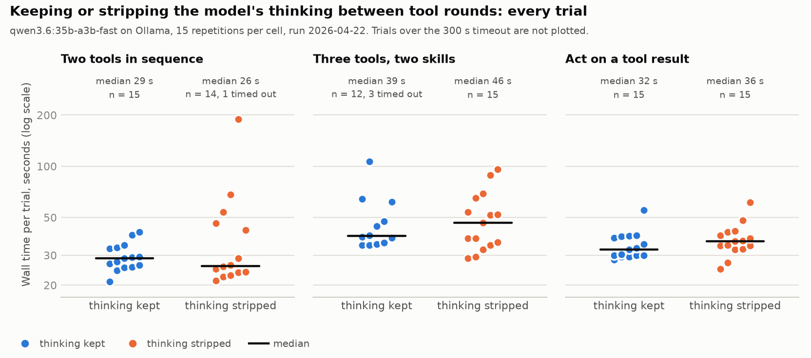

# Keep or strip a model's thinking between tool rounds

A small A/B harness, its saved transcripts, and what they do and do not show.

## The question

A local reasoning model (here `qwen3.6:35b-a3b-fast` on Ollama) returns a
`thinking` field with each reply. In an agent loop one user turn takes several
rounds: the model calls a tool, gets the result, calls another, then answers.
On each round the earlier assistant messages are sent back.

Should those replayed messages still carry their `thinking`?

- **keep**: round N's thinking is visible to the model in round N+1.
- **strip**: thinking is removed from replayed messages, so the model sees its
  earlier tool calls and their results but not why it made them.

Stripping saves context. The worry is that the model loses its plan part-way
through a multi-step task. Thinking from *earlier user turns* is stripped in
both conditions; only the within-turn behaviour is tested.

## Method

- `llm_experiments/thinking_strip/agent.py`: a minimal agent loop (standard
  library, one HTTP call per round, at most 6 rounds per turn). The only
  difference between conditions is one line that drops `thinking` from the
  messages before they are sent.
- `tools.py`: canned tools with the same shape as a real assistant's
  (`load_skill`, then `get_weather`, `remember`, `list_reminders`,
  `get_headlines`). Tools must be unlocked by `load_skill` first, so even a
  simple request takes 3 or more rounds. Tool results are fixed, so runs differ
  only in what the model does.
- `scenarios.py`: three prompts.

  | Scenario | Prompt | Needs |
  |---|---|---|
  | `multi_tool_chain` | save a monthly reminder, then list this week | 1 skill, 2 tools |
  | `three_tool_mixed_skills` | save a reminder, list this week, give the forecast | 2 skills, 3 tools |
  | `conditional_act_on_tool_output` | check Saturday's weather; if dry, save a reminder | read a tool result, then decide |

- `run.py`: 15 repetitions x 3 scenarios x 2 conditions = 90 trials, order
  shuffled with a fixed seed so warm-up and drift fall on both conditions.
  Each trial's full transcript is saved, including the thinking text, the tool
  calls, per-round wall time and the final answer.
- A request that takes more than 300 seconds is recorded as a timeout.

Run on 2026-04-22 on one machine. A 5-repetition pilot with four simpler
scenarios was run first (`results/20260422-104214`); the 15-repetition run is
`results/20260422-110428`.

## Results



Completed trials, wall time in seconds. "All tools" is how many trials called
every tool the prompt required.

| Scenario | Condition | n | Timeouts | Wall mean | Wall median | Rounds mean | All tools |
|---|---|---|---|---|---|---|---|
| multi_tool_chain | keep | 15 | 0 | 29.6 | 28.7 | 3.47 | 15/15 |
| multi_tool_chain | strip | 14 | 1 | 44.2 | 26.0 | 3.93 | 14/14 |
| three_tool_mixed_skills | keep | 12 | 3 | 48.3 | 38.8 | 3.00 | 12/12 |
| three_tool_mixed_skills | strip | 15 | 0 | 50.6 | 46.4 | 3.13 | 15/15 |
| conditional_act_on_tool_output | keep | 15 | 0 | 34.5 | 32.4 | 4.33 | 13/15 |
| conditional_act_on_tool_output | strip | 15 | 0 | 37.4 | 36.2 | 4.20 | 10/15 |

Strip minus keep, with a bootstrap 95% interval and a two-sided permutation
test (20,000 resamples; `python3 analyze.py` reproduces these):

| Scenario | Rounds | 95% interval | p | Wall s (mean) | 95% interval | p |
|---|---|---|---|---|---|---|
| multi_tool_chain | +0.46 | +0.19 to +0.73 | 0.014 | +14.6 | -2.3 to +40.2 | 0.19 |
| three_tool_mixed_skills | +0.13 | 0.00 to +0.33 | 0.49 | +2.3 | -13.7 to +17.0 | 0.78 |
| conditional_act_on_tool_output | -0.13 | -0.87 to +0.60 | 0.87 | +3.0 | -2.4 to +8.5 | 0.32 |

Task completion on the conditional scenario: keep 13/15, strip 10/15 (Fisher
exact p = 0.39).

## What can be concluded

- **On the two-tool chain, stripping cost about half an extra round per turn.**
  Keep finished in 3 rounds in 8 of 15 trials; strip took 4 rounds in 13 of
  14. The interval excludes zero. The same direction showed in the pilot
  (+0.2 rounds, n = 5 per cell). Seven comparisons are reported here, so a
  single p of 0.014 is suggestive, not proof.
- **Stripping did not make the model faster in any scenario.** The saving in
  prompt tokens did not show up as lower wall time. Every mean difference is
  positive and every interval includes zero.
- **The model wrote more thinking when its earlier thinking was hidden**, in
  all three scenarios: 3,597 characters per trial against 1,876 on the two-tool
  chain, 3,478 against 2,969, and 2,485 against 1,977. It re-derives the plan.

## What cannot be concluded

- **That stripping breaks plan-following.** 10/15 against 13/15 is the result
  the experiment was designed to find, and with 15 trials per cell it is
  indistinguishable from chance (p = 0.39). Detecting a difference of that
  size (87% against 67%) with 80% power needs roughly 70 trials per cell.
- **The headline +14.6 s on the two-tool chain.** One strip trial took 189 s.
  The medians go the other way (26.0 s against 28.7 s).
- **Anything about the trials that timed out.** 4 of 90 trials hit the 300 s
  limit: 3 in keep, 1 in strip. They have no wall time and are left out of the
  means, which flatters whichever cell they were in. Counting them at 300 s,
  the least they can have taken, would raise the keep mean on
  `three_tool_mixed_skills` from 48 s to about 99 s.
- **Anything about other models, quantisations, tool sets or prompts.** One
  model, one machine, one day, three prompts, canned tools. Wall time also
  includes whatever else the machine was doing.
- **Answer quality.** Only tool-call sequences were scored. The final answers
  are in the transcripts and were not graded.

The practical decision taken from this: keep within-turn thinking for this
model. The cost of keeping it is context, which was not the bottleneck; the
evidence that stripping hurts is weak but all points one way, and there is no
evidence that it helps.

## Model comparison

`llm_experiments/model_comparison/` reuses the scenarios to compare two models,
10 repetitions each (`results/20260423-075437`):

| Model | Output tokens/s | Wall mean per scenario | Timeouts | All tools |
|---|---|---|---|---|
| `qwen3.6:35b-a3b-fast` (mixture of experts, 3B active) | 30.2 | 42 to 57 s | 0 of 30 | 27/30 |
| `qwen3.6:27b` (dense) | 9.4 | 131 to 164 s | 4 of 30 | 23/26 |

The dense model was about 3.2 times slower per token on this machine and
showed no gain in task completion (the three missed trials in each column are
all on the conditional scenario). The speed difference is far outside the
noise; the completion rates are not distinguishable at this sample size.

One discrepancy to know about: the docstring and `summary.md` of this
experiment say within-turn thinking was kept, but `model_comparison/agent.py`
strips thinking from every replayed message. Both models therefore ran in the
*strip* condition. That does not affect the comparison between them. The
code and the saved summary are left as they were when the experiment ran.

## Files

```
llm_experiments/thinking_strip/     agent.py, tools.py, scenarios.py, run.py
  results/20260422-104214/          pilot: 40 transcripts, summary
  results/20260422-110428/          main run: 90 transcripts, summary
llm_experiments/model_comparison/   agent.py, run.py
  results/20260423-075437/          60 transcripts, summary
analyze.py                          re-derives every number above from the transcripts
plot_results.py                     draws results.png
```

`analyze.py`, `plot_results.py` and this README were written afterwards for
the write-up. The harness and the transcripts are unchanged apart from two
reworded docstrings in `tools.py`.

## Run it yourself

Needs [Ollama](https://ollama.com) on `127.0.0.1:11434` with the model pulled.
The model name is a constant at the top of `agent.py`.

```sh
python3 -m llm_experiments.thinking_strip.run        # 90 trials, about an hour
python3 -m llm_experiments.model_comparison.run
python3 analyze.py
uv run --with matplotlib python3 plot_results.py
```

Run from this directory. The fake weather data is dated for the week of
2026-04-22; the conditional scenario's "this Saturday" only has a right answer
if `tools.py` is given dates for the week you run it in.
